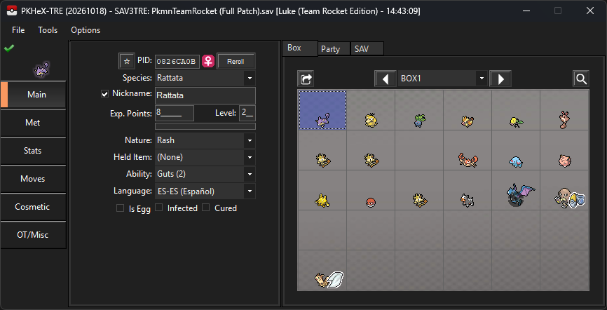
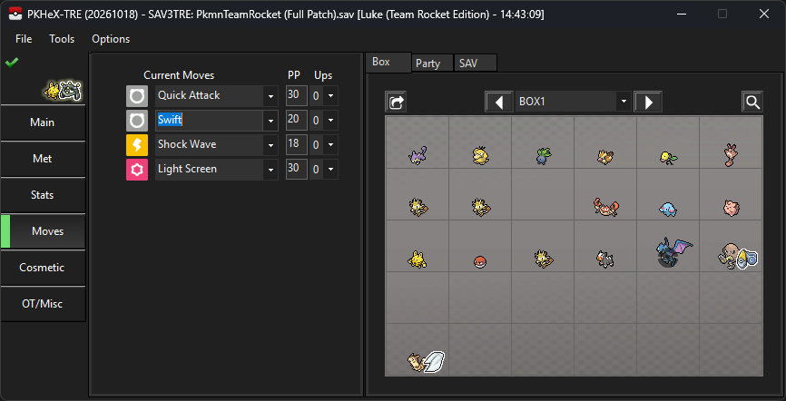
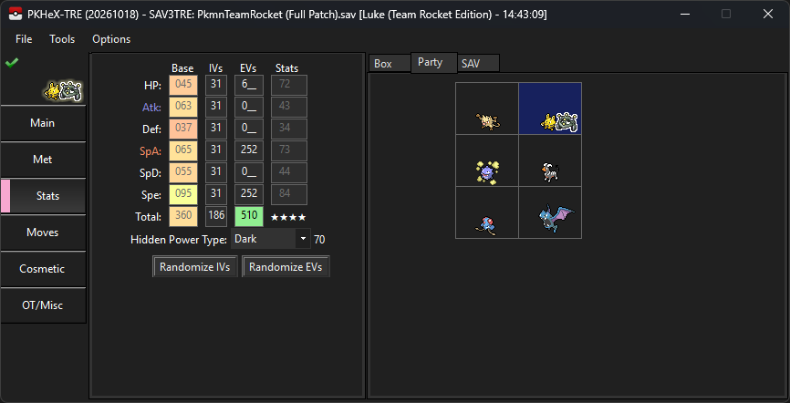
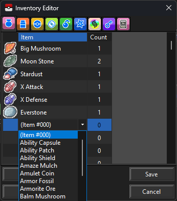
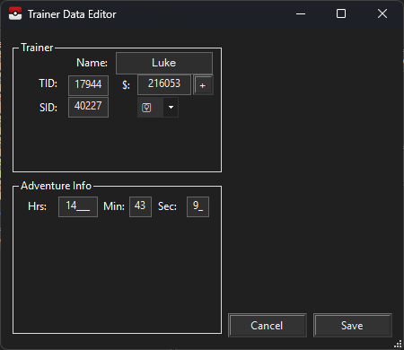

# PKHeX-TRE

**A save editor for the English translation of _Pokémon Team Rocket Edition v3.0.6_**

A fork of [PKHeX](https://github.com/kwsch/PKHeX) that can read and write Team Rocket Edition saves.

---

## Why a fork?

Team Rocket Edition is built on **pokeemerald-expansion**, and its saves aren't laid out like vanilla Emerald's.
Normal PKHeX can't open them. This fork adds the pieces needed to read them:

| | Vanilla Emerald | Team Rocket Edition |
|---|---|---|
| Save layout | 2 slots × 14 sectors | 1 slot × 28 sectors, its own signature |
| Boxes | 14 | 24 |
| Pokémon data | 3 ability bits, 8-bit met location | 3 ability slots, hidden nature, Tera type, 16-bit met location, 12-character nicknames |
| Species | 386 | 1,600+ entries: Gen 1–9 plus forms plus the hack's own Pokémon |
| Items and moves | Gen 3 IDs | The hack's own numbering |

All species stats, learnsets, item, move and ability names, and map names are pulled straight from the patched English ROM.

## Features

| Feature | Status |
|---|---|
| Open and save `.sav` files, with valid checksums | ✅ |
| Party and all 24 boxes | ✅ |
| Species, level, nickname, nature, IVs/EVs, friendship, shiny, ball, OT | ✅ |
| All three ability slots, including hidden abilities | ✅ |
| Held items, from the hack's own item list | ✅ |
| Moves checked against the hack's learnsets (level-up, TM/tutor, egg, pre-evolutions) | ✅ |
| Learnable moves highlighted in the move dropdowns | ✅ |
| Met locations, using the hack's own map names | ✅ |
| Box names | ✅ |
| Trainer info: name, IDs, gender, money, play time | ✅ |
| Bag: all 8 pockets (Items, Medicine, Balls, TMs/HMs, Berries, Held Items, Mega Stones, Key Items) plus the PC | ✅ |
| Badges | 🔜 |
| Sprites for the hack's own Pokémon | 🔜 (shows "?") |
| Form names matched to the hack's form order | 🔜 |

PKHeX's normal legality checker is switched off for these Pokémon, because its rules don't apply to a romhack. Only the move check runs.

## Screenshots

| Moves (checked against the hack's learnsets) | Stats |
|---|---|
|  |  |
| **Bag: the hack's 8 pockets** | **Trainer Info** |
|  |  |

## Download

Grab the latest `PKHeX-TRE.zip` from **[Releases](https://github.com/LukeU123/TRE-v3.0.6-PKHex/releases)**, extract it and run `PKHeX-TRE.exe`.
It needs the [.NET 10 Desktop Runtime](https://dotnet.microsoft.com/download/dotnet/10.0); Windows will prompt you if it's missing.

> [!IMPORTANT]
> **Always work on a copy of your save.** This is new software for an unofficial save format.

## Building it yourself

You need Visual Studio 2026 (18.x) with the **.NET desktop development** workload.

1. Open `PKHeX-TRE.sln..
2. Set the build to **Release** and make **PKHeX.WinForms** the startup project.
3. Choose *Build → Build Solution*. The first build downloads NuGet packages.
4. The program ends up in `PKHeX.WinForms\bin\Release\net10.0-windows\win-x64\PKHeX-TRE.exe`.

From the command line, run `dotnet publish PKHeX.WinForms -c Release`.

## How it works

| File | What it does |
|---|---|
| [`PKHeX.Core/Saves/TRE/SAV3TRE.cs`](PKHeX.Core/Saves/TRE/SAV3TRE.cs) | Save file: sector map, checksums, party, boxes, trainer block |
| [`PKHeX.Core/Saves/TRE/PK3TRE.cs`](PKHeX.Core/Saves/TRE/PK3TRE.cs) | The 80/100-byte Pokémon struct, with expansion bitfields, encryption and shuffle |
| [`PKHeX.Core/Saves/TRE/TREData.cs`](PKHeX.Core/Saves/TRE/TREData.cs) | Species/form mapping, move ID mapping (the hack has no Z-Moves), names |
| [`PKHeX.Core/Saves/TRE/TRELearn.cs`](PKHeX.Core/Saves/TRE/TRELearn.cs) | Move checking against the hack's learnsets |
| [`PKHeX.Core/Saves/TRE/tre_data.json`](PKHeX.Core/Saves/TRE/tre_data.json) | Data pulled from the ROM by [`tools-tre/gen_tre_data.py`](tools-tre/gen_tre_data.py) |
| [`PKHeX.WinForms/.../EditTRE.cs`](PKHeX.WinForms/Controls/PKM%20Editor/EditTRE.cs) | Loads and saves TRE Pokémon in the editor |

Small hooks elsewhere (`SaveUtil`, `GameStrings`, `FilteredGameDataSource`, `LegalityAnalysis`, `PKMEditor`, `SAVEditor`) are marked with `TRE` comments.

## Related

- 🇬🇧 **[TRE v3.0.6 English Translation](https://github.com/LukeU123/TRE-v3.0.6-English-Translation)**: the BPS patch this editor is built for.
- 🧰 **[PKHeX](https://github.com/kwsch/PKHeX)** by Kaphotics and contributors: the editor this is forked from. Its original README is in [`docs/upstream`](docs/upstream/README.md).

## Found a problem?

[Open an issue](https://github.com/LukeU123/TRE-v3.0.6-PKHex/issues/new/choose). A screenshot and the steps that caused it help a lot.
**Please don't attach your ROM.** A save file is fine if you're happy to share it.

## Licence

GPLv3, the same as PKHeX. See [`LICENSE`](LICENSE). No ROMs or copyrighted game data are distributed here.
Pokémon is © Nintendo, Game Freak and The Pokémon Company. Team Rocket Edition is the work of its own fan developers.
